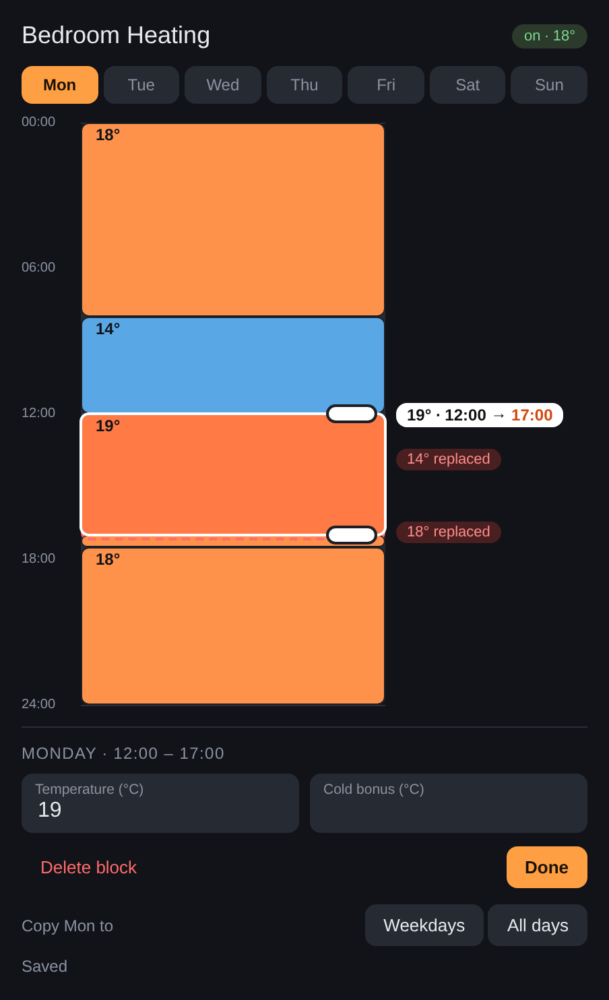

# Schedule Helper Card

A Lovelace card for viewing and editing native Home Assistant
[schedule helpers](https://www.home-assistant.io/integrations/schedule/), including the
per-block data (for example a target temperature). It needs no extra integration: it uses
the helper's own websocket API, the same one the built-in helper dialog uses.


## Editing

The card shows one day at a time as a vertical 24 hour timeline, with tabs for the days.
Blocks are coloured by their first field.

- **Add a block:** click the timeline where you want it, type a number, press Enter. The
  block is one hour long by default.
- **Change a block:** click its value to select it. Drag the start or end handle, or focus a
  handle and use the arrow keys (5 minutes, or an hour with Shift or Page Up and Page Down).
  Times snap to 5 minutes.
- **Pushing and replacing:** dragging an edge into a neighbour pushes the neighbour's
  boundary. Dragging over it completely replaces it. A chip and notes beside the timeline
  say what will happen. Press Escape while dragging to undo.
- **Following:** an edge that touches a neighbour is shared. Dragging it away from the
  neighbour pulls the neighbour's edge along, so no gap opens ("14° follows to 15:00"). The
  neighbour's far edge stays where it is, and the block you drag keeps the minimum length.
  Hold Alt while dragging, or use Alt with the arrow keys, to leave a gap instead.
- **Edit values:** the panel under the timeline edits every configured field of the selected
  block, and has Delete block. Clearing an optional field removes it.
- **Copy a day:** copy the current day to the weekdays or to all days (it asks first).

Edits are saved as you make them. A gap, which the helper treats as off, appears only where
you make one: with Alt, by deleting a block, or by moving an edge that has no neighbour
touching it (including the first start and the last end of the day). Block data keys the card is not configured for are kept as they
are.

Helpers that are not stored in the UI (for example ones defined in YAML) are shown read only.

Dragging an edge over a neighbour replaces it, and the chip and notes beside the timeline say
what will happen before you let go:



## Installation

Add this repository to HACS as a custom repository of type "Dashboard", install it, and
add the resource if HACS does not.

## Configuration

```yaml
type: custom:schedule-helper-card
entity: schedule.heating
fields:
  - key: target_temperature
    label: Temperature
    unit: °C
    step: 0.5
    min: 5
    max: 30
```

| Option           | Default     | Description                                                        |
| ---------------- | ----------- | ------------------------------------------------------------------ |
| `entity`         | required    | A `schedule.` helper.                                              |
| `name`           | helper name | Card title.                                                        |
| `fields`         | one `value` | Numbers stored in each block's data. The first is typed on create. |
| `hour_height`    | `18`        | Pixels per hour on the timeline.                                   |
| `step`           | `5`         | Minutes that edges snap to.                                        |
| `min_length`     | `5`         | Shortest block, in minutes.                                        |
| `default_length` | `60`        | Length of a newly created block, in minutes.                       |
| `merge_equal`    | `false`     | Join touching blocks with identical data after an edit.            |

Each field takes `key` (the data key), and optionally `label`, `unit`, `step`, `min` and
`max`. Values are clamped to `min` and `max`.

### Heating example

Each room has a schedule helper whose blocks carry a target temperature and, for some rooms,
a cold bonus that an automation adds when it is cold outside.

```yaml
type: vertical-stack
cards:
  - type: custom:schedule-helper-card
    entity: schedule.bedroom_heating
    fields:
      - key: target_temperature
        label: Temperature
        unit: °C
        step: 0.5
        min: 5
        max: 30
      - key: cold_bonus
        label: Cold bonus
        unit: °C
        step: 0.5
        min: 0
        max: 5
  - type: custom:schedule-helper-card
    entity: schedule.guest_room_heating
    fields:
      - key: target_temperature
        label: Temperature
        unit: °C
        step: 0.5
        min: 5
        max: 30
```

## How it talks to Home Assistant

- Read: `schedule/list` (the stored items, which keep `24:00:00` ends). Helpers not found
  there are read with the `schedule.get_schedule` service and shown read only.
- Write: `schedule/update` with the whole item. The update replaces the item, so the name and
  icon are sent back with every save.
- Home Assistant rejects overlapping blocks. The editing model never produces them.
- A block that ends at 23:59 or later is treated as ending at 24:00.

## Development

Everything runs through npm scripts (`make install`, `make lint`, `make test`,
`make build`). The bundle is written to `dist/schedule-helper-card.js` and is attached to
each GitHub release by CI. Do not install Node tooling on a host that should stay clean; run
the scripts in a Node container.

The editing rules live in `src/model` and have no DOM dependency, so they are tested on
their own. `src/schedule-helper-card.ts` is the Lit card on top.

## Licence

MIT
